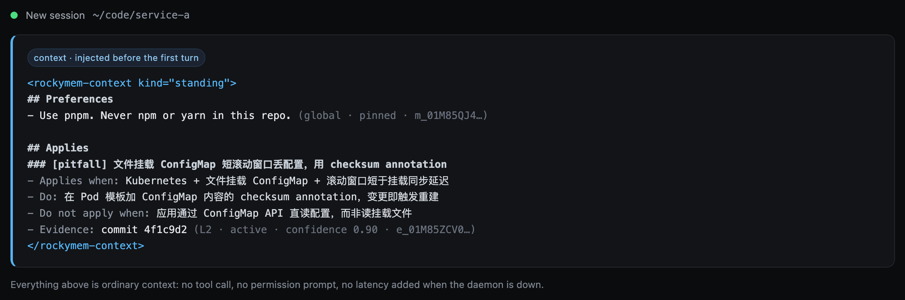

<p align="center">
  
</p>

<h1 align="center">rocky-mem-dsh</h1>

<p align="center"><strong>Your agent stops re-learning what your team already knows.</strong><br>
A DeepSeek Harness bundle for the <a href="https://github.com/linyu19872008/rocky-mem">rocky-mem</a> experience ledger.</p>

<p align="center">
  <a href="https://github.com/linyu19872008/rocky-mem-dsh/actions/workflows/ci.yml"></a>
  <a href="https://www.npmjs.com/package/rocky-mem-dsh"></a>
  <a href="LICENSE"></a>
  
  <br>
  <sub><strong>English</strong> · <a href="README.zh-CN.md">中文</a></sub>
</p>

---

## The problem

Every session starts from zero. The last investigation — what was tried, what
failed, why the fix worked, and under which conditions it breaks again — lives
in a chat log nobody reads. A commit records *what* changed, not *why*.

rocky-mem keeps that ledger. **This plugin decides when to hand it to the agent**,
and gets out of the way the rest of the time.

## What you get

- **Context before the first turn.** Preferences and pinned lessons for the
  working directory arrive as one tagged block — no tool call, no prompt.
- **Six tools** (`mcp__rockymem__*`) for search, write, read, feedback.
- **The `rocky-mem` skill**, so the agent knows when a recorded lesson must
  *not* be applied.
- **Silent degradation**: if the ledger is down, the session is unaffected.




## Quick start

Two moving parts: the ledger daemon, and this bundle.

```sh
# 1. the server (see its README for go install / prebuilt binaries)
rockymem serve --dsn sqlite://$HOME/.local/share/rocky-mem/rocky-mem.db

# 2. the bundle
dsh plugin --profile web add rocky-mem-dsh
#    or: install "rocky-mem-dsh" from the Plugins page

# 3. restart dsh web
```

**What you should see:** start a new session. Its first message contains a
`<rockymem-context kind="standing">` block with your preferences. Ask the agent
to run `/rockymem status` — it reports the endpoint, contract version, and how
many packs were injected:

```
rocky-mem — http://127.0.0.1:7432
contract 1 · server 0.2.2 · features context,search,get,…,mcp.streamable-http
injected 1 · skipped none
inject=on preStep=off budget=500/400
```

Nothing to inject yet? Record a preference once (`mem_remember`) or a lesson
(`mem_record`), then open another new session.

## How it works

| Layer | Responsibility | Lives in |
|---|---|---|
| Correctness | gates, ranking, pack assembly, conflict handling | the `rocky-mem` server |
| **Timing** | when to inject, budgets, circuit breaker, degradation | **this plugin** |
| Behaviour | how the agent should use the tools | the `rocky-mem` skill |

```
agent/created ──▶ rockymem-runtime ──HTTP──▶ POST /api/v1/context ──▶ agent.inject()
agent/pre-step ─▶ (opt-in) ────────────────▶ POST /api/v1/search  ──▶ appended message
tool call ─────▶ dsh-mcp-client ──stdio───▶ rockymem mcp ──▶ the daemon
```

The plugin holds no knowledge of its own: it reads `doctor` to see what the
server supports, asks for a pack, and injects it. The server owns every decision
about what is true.

## Configuration

Everything has a working default. Overrides go in the profile's
`cordis.patch.yml`, keyed by entry id (`rockymem-runtime`, `mcp-rockymem`).

| Key | Default | Meaning |
|---|---|---|
| `endpoint` | `http://127.0.0.1:7432` | daemon base URL (`ROCKYMEM_URL` wins) |
| `tokenFile` | `~/.local/share/rocky-mem/rocky-mem.token` | bearer token (`ROCKYMEM_TOKEN` wins) |
| `doctorCacheMs` | `60000` | capability-probe cache |
| `inject.enabled` | `true` | session-start injection |
| `inject.onSources` | `[startup, clear]` | `SessionStartSource` values that receive it |
| `inject.budgetTokens` | `500` | pack ceiling |
| `inject.timeoutMs` | `150` | hard per-call budget |
| `preStep.enabled` | **`false`** | task-time retrieval |
| `preStep.budgetTokens` | `400` | pack ceiling per turn |
| `preStep.minPromptChars` | `12` | shorter prompts are never searched |

The token is written by `rockymem serve` next to its database
(`<db-stem>.token`, mode 600) or under `$ROCKYMEM_HOME/pg-<hash>/`.

## Turn on task-time retrieval

`agent/pre-step` runs on every step, so this is opt-in:

```yaml
- id: rockymem-runtime
  config:
    preStep:
      enabled: true
```

It makes retrieval *deterministic* instead of hoping the model calls
`mem_search`, at the cost of one HTTP call and up to 400 tokens per turn.

Measured on a real store, 6 realistic queries at `budget=400`:

| Result | Queries | Approx. tokens |
|---|---:|---:|
| Hit an experience section | 1 | 250 |
| Matched only the standing preference | 5 | 42 each |

The standing preference is already injected at session start, so five of six
injections would have been pure duplication. That is why a pack with no
`## Applies` or `## Do not use` section is skipped, and why the default is off.

## Transports

The MCP entry ships on **stdio**: `rockymem mcp` reads the token file itself and
proxies to a running daemon, so no secret appears in configuration.

Switch to **Streamable HTTP** when the daemon is remote, or when you would rather
not spawn a child process per client:

```yaml
- id: mcp-rockymem
  config:
    transport: streamable-http
    url: http://127.0.0.1:7432/mcp
    headers:
      Authorization: !!js '`Bearer ${process.env.ROCKYMEM_TOKEN}`'
```

The HTTP transport is stateless; `GET /mcp` answers `405` by design.

## Failure behaviour

A memory service that is down must never slow a session down.

| Situation | Behaviour |
|---|---|
| daemon stopped | no injection; one warning at load; session unaffected |
| call exceeds the budget | that injection is dropped |
| 3 consecutive failures | circuit opens for 60 s; no calls are attempted |
| `doctor` lacks `context` | injection skipped (older server) |
| subagent session | never injected |
| pack has no experience section | skipped (task-time only) |

## Privacy

- Talks only to the `endpoint` you configure; no telemetry, no other hosts.
- Sends the working directory, and when `preStep` is on, the first prompt of a
  turn — only to that daemon.
- Never reads the rocky-mem database or configuration files, and runs no
  install-time scripts.

Details and the threat model: [SECURITY.md](SECURITY.md).

## Compatibility

| This bundle | DSH | rocky-mem contract |
|---|---|---|
| 0.1.x | `>= 0.2.2-rc.1` | 1 |
| Node | `^22.19` or `>=24` | — |

`engines.dsh` is declared because the bundle uses `agent/pre-step` and
`ctx.skills.registerProvider`. Marketplace cards filter on it, so an
"incompatible" label on the Plugins page means the DSH release is too old — not
that the plugin is broken.

## Troubleshooting

| Symptom | Check |
|---|---|
| No context block appears | `/rockymem status` — `injected 0` plus a skip reason |
| `skipped no-feature` | the server predates `context`; upgrade rocky-mem |
| `skipped disabled` | something ran `/rockymem off` in this process |
| `skipped empty-pack` | the ledger has nothing for this directory yet — record something |
| Tools missing from the model | `rockymem mcp` failed to spawn; run it in a terminal and read the error |
| `daemon unreachable` at load | `rockymem serve` is not running, or `endpoint` is wrong |

Server-side diagnosis: `rockymem doctor --dsn <your DSN>`.

## Uninstall

Remove the bundle on the Plugins page (or `dsh plugin --profile web remove
rocky-mem-dsh`). The daemon and its database are separate and untouched — remove
them only if you want the ledger gone.

## Development

```sh
npm test                       # 15 cases, no daemon, no network
npm pack --dry-run             # the exact file list that ships
node scripts/check-readme.mjs  # bilingual structure + links + locale metadata
```

Read [CONTRIBUTING.md](CONTRIBUTING.md) before a change: the rule that matters
most is that a failed memory service must never become a failed session.

## Related

| | |
|---|---|
| [rocky-mem](https://github.com/linyu19872008/rocky-mem) | the ledger server, MCP contract, ADRs |
| [rocky-mem-skill](https://www.npmjs.com/package/rocky-mem-skill) | the portable skill for other hosts |
| [DeepSeek Harness](https://github.com/deepseek-ai/deepseek-harness) | the host this bundle plugs into |

## License

MIT — see [LICENSE](LICENSE). By participating you agree to the
[code of conduct](CODE_OF_CONDUCT.md).
