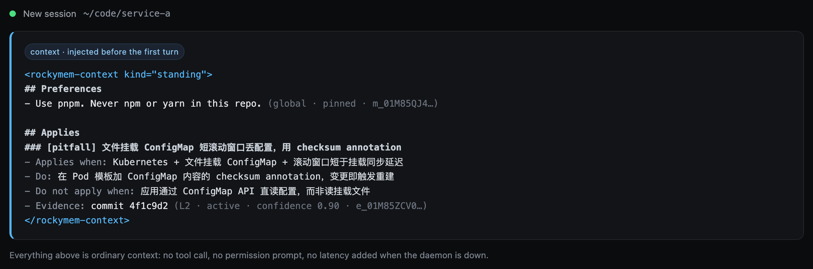

<p align="center">
  
</p>

<h1 align="center">rocky-mem-dsh</h1>

<p align="center"><strong>让 agent 不再重新踩团队已经踩过的坑。</strong><br>
面向 <a href="https://github.com/linyu19872008/rocky-mem">rocky-mem</a> 经验台账的 DeepSeek Harness 插件包。</p>

<p align="center">
  <a href="https://github.com/linyu19872008/rocky-mem-dsh/actions/workflows/ci.yml"></a>
  <a href="https://www.npmjs.com/package/rocky-mem-dsh"></a>
  <a href="LICENSE"></a>
  
  <br>
  <sub><a href="README.md">English</a> · <strong>中文</strong></sub>
</p>

---

## 问题

每个会话都从零开始。上一次排查——试过什么、什么失败了、为什么最后修好了、什么条件下又会坏——全都留在没人会翻的聊天记录里。commit 只记录**改了什么**，不记录**为什么**。

rocky-mem 保存这本台账。**这个插件负责决定什么时候把台账递给 agent**，其余时间安静地待着。

## 你会得到什么

- **第一轮对话之前就有上下文。** 当前工作目录的偏好与置顶经验，作为一个带标签的块送达——不需要工具调用，不需要提示。
- **六个工具**（`mcp__rockymem__*`），覆盖检索、写入、读取、反馈。
- **`rocky-mem` 技能**：让 agent 知道某条经验在什么条件下**不该**使用。
- **静默降级**：台账服务挂了，会话照常进行。




## 快速开始

两个部分：台账守护进程，以及这个插件包。

```sh
# 1. 服务端（go install 或预编译二进制，见其 README）
rockymem serve --dsn sqlite://$HOME/.local/share/rocky-mem/rocky-mem.db

# 2. 插件包
dsh plugin --profile web add rocky-mem-dsh
#    或者在 Plugins 页安装 "rocky-mem-dsh"

# 3. 重启 dsh web
```

**你应该看到：** 新建一个会话，第一条消息里出现 `<rockymem-context kind="standing">` 块，内容是当前目录的偏好。让 agent 执行 `/rockymem status`，它会报告地址、契约版本，以及注入了几个上下文包：

```
rocky-mem — http://127.0.0.1:7432
contract 1 · server 0.2.2 · features context,search,get,…,mcp.streamable-http
injected 1 · skipped none
inject=on preStep=off budget=500/400
```

还没有内容可注入？先用 `mem_remember` 记一条偏好，或用 `mem_record` 记一条经验，然后再开一个新会话。

## 工作原理

| 层 | 职责 | 位置 |
|---|---|---|
| 正确性 | 闸门、排序、上下文包装配、冲突处理 | `rocky-mem` 服务端 |
| **时机** | 何时注入、预算、熔断、降级 | **本插件** |
| 行为 | agent 该如何使用这些工具 | `rocky-mem` 技能 |

```
agent/created ──▶ rockymem-runtime ──HTTP──▶ POST /api/v1/context ──▶ agent.inject()
agent/pre-step ─▶ （可选）─────────────────▶ POST /api/v1/search  ──▶ 追加一条消息
工具调用 ──────▶ dsh-mcp-client ──stdio───▶ rockymem mcp ──▶ 守护进程
```

插件本身不持有任何知识：它读 `doctor` 看服务端支持什么，请求一个上下文包，然后注入。什么为真，全部由服务端决定。

## 配置

所有项都有可用默认值。覆盖项写在 profile 的 `cordis.patch.yml` 里，按条目 id（`rockymem-runtime`、`mcp-rockymem`）定位。

| 键 | 默认 | 含义 |
|---|---|---|
| `endpoint` | `http://127.0.0.1:7432` | 守护进程地址（`ROCKYMEM_URL` 优先） |
| `tokenFile` | `~/.local/share/rocky-mem/rocky-mem.token` | bearer token（`ROCKYMEM_TOKEN` 优先） |
| `doctorCacheMs` | `60000` | 能力探测缓存 |
| `inject.enabled` | `true` | 会话启动注入 |
| `inject.onSources` | `[startup, clear]` | 会收到注入的 `SessionStartSource` |
| `inject.budgetTokens` | `500` | 上下文包上限 |
| `inject.timeoutMs` | `150` | 单次调用硬超时 |
| `preStep.enabled` | **`false`** | 任务检索 |
| `preStep.budgetTokens` | `400` | 每轮上下文包上限 |
| `preStep.minPromptChars` | `12` | 更短的提示词不检索 |

token 由 `rockymem serve` 写在数据库旁边（`<db-stem>.token`，权限 600），或位于 `$ROCKYMEM_HOME/pg-<hash>/`。

## 打开任务检索

`agent/pre-step` 每一步都会触发，所以默认关闭：

```yaml
- id: rockymem-runtime
  config:
    preStep:
      enabled: true
```

它把检索从"赌模型会调 `mem_search`"变成**确定性注入**，代价是每轮一次 HTTP 调用、最多 400 token。

在真实库上实测，6 条真实查询（`budget=400`）：

| 结果 | 查询数 | 近似 token |
|---|---:|---:|
| 命中经验段 | 1 | 250 |
| 只命中常驻偏好 | 5 | 各 42 |

常驻偏好在会话启动时已经注入过了，所以 6 次里有 5 次是纯重复。这就是"没有 `## Applies` / `## Do not use` 段的包直接跳过"以及默认关闭的原因。

## 传输方式

MCP 条目默认走 **stdio**：`rockymem mcp` 自己读 token 文件并代理到运行中的守护进程，所以配置里不出现任何密钥。

当守护进程在远端，或者你不想为每个客户端派生一个子进程时，切到 **Streamable HTTP**：

```yaml
- id: mcp-rockymem
  config:
    transport: streamable-http
    url: http://127.0.0.1:7432/mcp
    headers:
      Authorization: !!js '`Bearer ${process.env.ROCKYMEM_TOKEN}`'
```

HTTP 传输是无状态的；`GET /mcp` 按设计返回 `405`。

## 失败行为

记忆服务挂掉，绝不能把会话拖垮。

| 情况 | 行为 |
|---|---|
| 守护进程停止 | 不注入；加载时一条警告；会话不受影响 |
| 调用超出预算 | 丢弃这次注入 |
| 连续 3 次失败 | 熔断 60 秒，期间不再发起调用 |
| `doctor` 没有 `context` | 跳过注入（服务端版本较旧） |
| 子 agent 会话 | 永不注入 |
| 上下文包没有经验段 | 跳过（仅任务检索） |

## 隐私

- 只与你配置的 `endpoint` 通信；没有遥测，不访问其他主机。
- 会发送工作目录；开启 `preStep` 时还会发送当轮的第一条提示词——且只发给那个守护进程。
- 从不读取 rocky-mem 的数据库或配置文件，也没有安装期脚本。

细节与威胁模型见 [SECURITY.md](SECURITY.md)。

## 兼容性

| 本插件包 | DSH | rocky-mem 契约 |
|---|---|---|
| 0.1.x | `>= 0.2.2-rc.1` | 1 |
| Node | `^22.19` 或 `>=24` | — |

声明 `engines.dsh` 是因为插件用到了 `agent/pre-step` 与 `ctx.skills.registerProvider`。市场卡片据此过滤，所以 Plugins 页显示"不兼容"意味着 DSH 版本太旧，而不是插件坏了。

## 故障排查

| 症状 | 检查 |
|---|---|
| 看不到上下文块 | `/rockymem status` —— `injected 0` 并带跳过原因 |
| `skipped no-feature` | 服务端版本早于 `context`，升级 rocky-mem |
| `skipped disabled` | 当前进程执行过 `/rockymem off` |
| `skipped empty-pack` | 该目录还没有任何内容，先记一条 |
| 模型看不到工具 | `rockymem mcp` 启动失败；在终端里直接跑一遍看报错 |
| 加载时报 `daemon unreachable` | `rockymem serve` 没在运行，或 `endpoint` 写错 |

服务端诊断：`rockymem doctor --dsn <你的 DSN>`。

## 卸载

在 Plugins 页移除插件包（或执行 `dsh plugin --profile web remove rocky-mem-dsh`）。守护进程与它的数据库是独立的，不会被改动——只有你确实想删掉台账时才需要清理它们。

## 开发

```sh
npm test                       # 15 个用例，不需要守护进程与网络
npm pack --dry-run             # 实际会打包的文件清单
node scripts/check-readme.mjs  # 双语结构 + 链接 + locale 元数据校验
```

改代码前请读 [CONTRIBUTING.md](CONTRIBUTING.md)：最重要的一条是——**记忆服务失败，绝不能变成会话失败**。

## 相关项目

| | |
|---|---|
| [rocky-mem](https://github.com/linyu19872008/rocky-mem) | 台账服务端、MCP 契约、ADR |
| [rocky-mem-skill](https://www.npmjs.com/package/rocky-mem-skill) | 给其他宿主的可移植技能 |
| [DeepSeek Harness](https://github.com/deepseek-ai/deepseek-harness) | 插件所依附的宿主 |

## 许可证

MIT —— 见 [LICENSE](LICENSE)。参与即表示同意[行为准则](CODE_OF_CONDUCT.md)。
